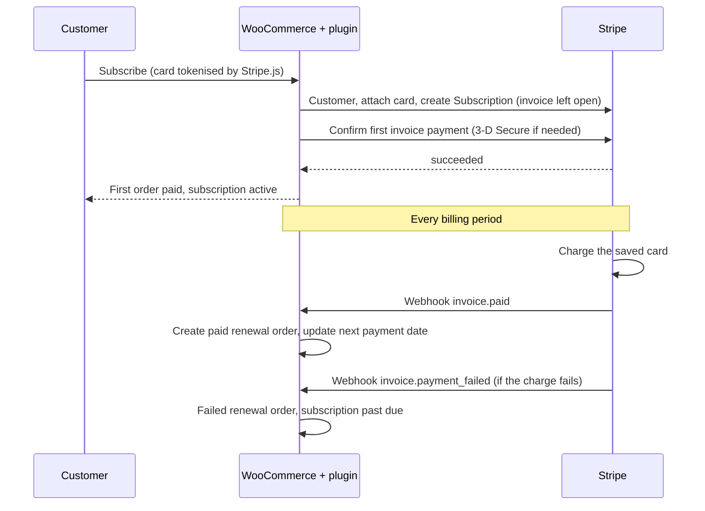

# Recurring Billing for WooCommerce

A WooCommerce plugin that sells **subscription products** with **Stripe Billing**. Stripe charges each renewal on schedule; **webhooks** turn those charges into WooCommerce renewal orders, so orders, payments and subscription status stay in sync without manual work.

> Portfolio / demo project written from scratch. It is not client code.

## Features

- **Subscription products**: tick "Subscription" on a simple product and choose weekly, monthly or yearly billing
- **Stripe checkout** on the classic WooCommerce checkout (card field via Stripe.js), with **3-D Secure** support on the first payment
- **Automatic renewals**: Stripe bills the saved card; the plugin creates a paid **renewal order** for every successful invoice
- **Failed renewals**: a failed renewal order is created, the subscription is marked *past due*, and WooCommerce's failed-order email goes to the admin. If Stripe's retry succeeds, the same order is marked paid
- **Customer self-service**: a *Subscriptions* tab in My Account to cancel (ends after the paid period) or resume
- **Admin list** of all subscriptions under *WooCommerce > Subscriptions* (customer, product, amount, status, next payment)
- **Secure webhooks**: Stripe signature verified (HMAC-SHA256, 5-minute tolerance), duplicate events ignored, renewal orders are idempotent per invoice
- Compatible with **HPOS** (High-Performance Order Storage)

## How it works



## Requirements

- WordPress 6.0+, PHP 7.4+
- WooCommerce (classic shortcode checkout)
- A Stripe account (free; test mode needs no verification)
- A publicly reachable site for webhooks (or the Stripe CLI when testing locally)

## Installation

1. Copy the `wc-recurring-billing` folder to `wp-content/plugins/`, or upload the zip under *Plugins > Add New > Upload*, then activate it.
2. Go to *WooCommerce > Settings > Payments > Stripe Subscriptions*, enable it, keep **Test mode** on, and paste your Stripe **test** publishable and secret keys.
3. Create a **webhook endpoint** in Stripe (Developers > Webhooks) pointing to:
   `https://YOUR-SITE/wp-json/wrb/v1/webhook`
   Select these events: `invoice.paid`, `invoice.payment_failed`, `customer.subscription.updated`, `customer.subscription.deleted`.
   Choose API version **2024-06-20** if Stripe offers the choice. Copy the endpoint's **signing secret** into the plugin's *Test webhook signing secret* field.
4. Edit a simple product, tick **Subscription** (under the price), choose an interval, and set it to virtual.
5. Buy it from the storefront. After the first payment you will find the subscription under *WooCommerce > Subscriptions* and in *My Account > Subscriptions*.

### Testing webhooks on your own computer

```
stripe listen --forward-to http://localhost/wp-json/wrb/v1/webhook
```
Use the `whsec_...` secret the CLI prints as the webhook signing secret.

### Testing renewals without waiting a month

In the Stripe dashboard use **Test clocks**: create a test clock, add a customer to it (or create the subscription through a clock-attached customer), then advance time past the renewal date. Stripe will fire `invoice.paid` and you should see a new renewal order appear.

| Card number | Result |
|---|---|
| `4242 4242 4242 4242` | First payment and renewals succeed |
| `4000 0025 0000 3155` | Asks for 3-D Secure on the first payment |
| `4000 0000 0000 0341` | Card saves fine, but renewal charges fail (tests the failed-payment flow) |

Use any future expiry date and any CVC.

## Project structure

```
wc-recurring-billing/
├── wc-recurring-billing.php             # bootstrap, HPOS declaration, rewrite flush on activation
├── includes/
│   ├── class-wrb-product.php            # subscription product fields + cart rules
│   ├── class-wrb-gateway.php            # Stripe gateway: customer, subscription, first payment, 3-D Secure
│   ├── class-wrb-webhook.php            # signed webhook endpoint, renewal orders, status sync
│   ├── class-wrb-subscription.php       # local subscription records + admin list
│   ├── class-wrb-account.php            # My Account tab, cancel / resume
│   └── class-wrb-stripe-api.php         # small Stripe REST client (no SDK)
└── assets/js/checkout.js                # Stripe Elements + PaymentMethod creation
```

## Design decisions

- **Stripe is the source of truth for billing.** WooCommerce keeps a mirror (subscription record and orders), updated by webhooks, so a missed browser redirect never leaves the store out of sync.
- **Records are saved before the first payment is confirmed**, so an early webhook can always find them.
- **One subscription per order, no coupons, account required.** This keeps the recurring price equal to the first order total and gives every subscription an owner.
- **Cancelling ends at the period end**, so customers keep what they paid for.

## Known limitations

- Works with the **classic checkout**, not the block-based checkout.
- One subscription product per order; intended for **virtual products or memberships** (shipping is not recalculated on renewals).
- The recurring price is the first order total (tax included). Later changes to tax rates or product prices are **not** applied to existing subscriptions.
- No free trials, plan upgrades/downgrades, proration, or coupons.
- Admins cannot cancel from WordPress (cancel in the Stripe dashboard; the webhook updates the store).
- No automated tests yet.

## Roadmap

- Free trials (SetupIntent flow), coupons and sign-up fees
- Plan switching with proration
- Admin-side cancel and refund actions
- WooCommerce Blocks checkout support
- Unit tests for the webhook handlers

## License

MIT. See [LICENSE](LICENSE).
